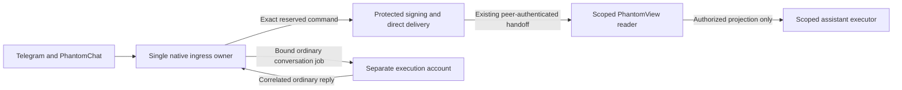

# Native channel host isolation design

Historical alternative: the whole-daemon trust decision in
[DAEMON_TRUST.md](DAEMON_TRUST.md) supersedes the mandatory issuer/model account
split below for the current integration. Preserve these design notes for
installations that independently require isolation; do not treat them as the AU
deployment checklist. The reviewed release parity check is also documented there.

Status: reviewed source baseline and implementation contract, **not a host
implementation or deployment approval**. The existing AU assistant remains in its
current mode. The private adapters alone cannot establish this boundary.

## Decision

Keep one native ingress owner multiplexing configured personas and channels.
Separate its Linux account from the reader and every inference/tool account.
Keep ordinary conversation execution behind that boundary, with its existing
persona identity, memory, JEV screening and fallback behavior. A new per-persona
supervisor or second Telegram consumer is not part of this design.

The ingress owner must use the native transport/parser and verified PhantomChat
unwrap, but cannot reuse the complete current server loops as its host. Those
loops execute models and helpers. The opt-in hooks are tested integration seams;
passing an issuer UID to them does not make the surrounding loop isolated.



The issuer is a role within the protected ingress account, not a new network
service. The scoped assistant executor can use a separate model account from
ordinary execution; both belong in the explicit model UID inventory. Do not pass
channel credentials, signing keys, reader sockets or inherited connected file
descriptors into either execution environment.

## Observed execution surfaces

Baseline: PhantomBot `5af27060327ee8c53fe730dd8b98b6b305c62add`, before private
patches. Paths below identify review surfaces, not an exhaustive static call graph.

| Source | Consequence for the split |
| --- | --- |
| `src/cli/run.ts` | Builds multiple harness chains, starts both channels, owns lifecycle notifications and the durable-fact extraction drain. Moving just the foreground turn is insufficient. |
| `src/channels/core/engine.ts` | Telegram authorization, inline commands, voice/media handling and queued model turns share the server. Preserve command responsiveness and per-conversation ordering. |
| `src/channels/phantomchat/server.ts` | Verified listener output enters tier, group, media, reaction, command and model paths. Preserve explicit principals versus relay/open/TOFU distinctions. |
| `src/orchestrator/turn.ts` | Turn coordination, retrieval, native screening and persistence belong to the execution side. The scoped assistant continues to use its separate projection-only executor. |
| `src/orchestrator/screen.ts`, `src/lib/threatJudge.ts`, `src/lib/decisionModelJudge.ts`, `src/lib/decisionModelRouter.ts` | Decision-model requests and harness fallback judges are inference, including failures and recovery. They cannot execute under the issuer account. |
| `src/orchestrator/fallback.ts`, `src/orchestrator/recovery.ts` | Primary, retry, resume, recovery and fallback must all cross the same account boundary. No local fallback on a worker outage. |
| `src/harnesses/`, `src/lib/harnessRunner.ts`, `src/lib/vault.ts` | Provider access, tools, subprocess environment and credential loading require explicit role-specific stores. A full persona-vault copy would reintroduce channel secrets into execution. |
| `src/cli/ask.ts`, `src/cli/tick.ts`, `src/cli/heartbeat.ts`, `src/cli/nightly.ts`, `src/engine/` | Out-of-band and embedded entry points must remain outside the issuer account. Existing scheduled execution must be included in the account inventory. |
| `src/channels/commands.ts`, `src/lib/audio.ts` | Preserve normal commands and media functions through explicit role-specific operations. Do not give a model-controlled worker an arbitrary host command, file path or outbound destination. |

## Two separate protocols

Access issuance retains the existing signed NIP-98 event, Unix peer-authenticated
reader handoff, fixed origin, allowlist, replay and single-use fragment redemption.
The trusted ingress constructs context only from native verified source metadata.
It consumes every reserved command variant before ordinary dispatch. Protected
signing and same-sender delivery must honor cancellation and finite deadlines.
Ambiguous delivery consumes the attempt without automatic retry.

Ordinary conversation forwarding needs a different, explicitly typed protocol;
it must never accept an access-issuance operation. Its implementation must:

1. Authenticate both process accounts before sending identity or prompt bytes,
   using protected Unix socket paths and Linux peer credentials. Bound frames,
   queue size, total deadline and output; close descriptors on process launch.
2. Bind a server-created job ID to the immutable persona, channel, conversation,
   reply audience and authorization tier. Workers cannot choose a recipient,
   promote a relay/open sender or fabricate native source authority.
3. Return only correlated reply events. Unknown, duplicate, expired or cancelled
   job IDs fail closed. A worker cannot submit an access context, signed event,
   arbitrary transport operation or service-management command in a reply.
4. Preserve serial turns per conversation, bounded parallelism across conversations,
   `/stop` responsiveness and cancellation acknowledgment. Never retry an
   ambiguous outbound send automatically. Retain native checkpoints across restarts.
5. Preserve JEV and its hold behavior in the execution domain, including fallback
   judges and recovery. Keep hold/error content out of unrestricted fallback paths.
6. Keep native control commands separate from model replies. Inventory every
   existing command and assign it to protected control, model-side configuration
   or ordinary turn processing before cutover. Unsupported commands must have a
   visible fixed response; they must not silently disappear or become host shell
   instructions. Worker replies cannot invoke this control route.

This contract intentionally does not expose a new browser identity API, model tool
or general remote shell. It supplies no forwarding implementation yet.

## Source compatibility gate

Run against an unchanged offline copy, before applying private patches:

```bash
python3 native_host_review.py /offline/phantombot-source
```

`native-host-review.json` records a deterministic digest of all files under `src/`
plus the dependency lock, package/build configuration and root contributor/user
documentation. It detects additions, removals and changes, including model paths
outside the listed surfaces. Only line endings are normalized. The tool does not
execute the inspected source, load persona data, inspect running processes, access
the network or write into the checkout. Linked paths and excessive inputs fail.

Exit zero means only that source matches this review baseline. The JSON always
reports `activation_ready: false`. Exit two means the review failed. Neither a
matching digest nor a version string proves source authenticity, complete build
inputs, absence of vulnerabilities or runtime separation. Acquire the exact
revision through the trusted checkout workflow, verify installed binary build
provenance separately and rerun against a quiescent disposable tree. This check
does not include external extensions, generated assets, dependencies or deployment
configuration. Do not run it on an active persona store.

The installed AU provenance inspected earlier differs from this revision. Rebase
and review against the actual release, or stage a fully reviewed replacement
artifact; do not edit the installed tree to make a digest match. No command in
this document upgrades a service or grants access.

## Implementation and cutover gates

1. Build and test the bounded ordinary-execution protocol and account separation
   with synthetic transports and real separate Linux UIDs on an ephemeral runner.
   Prove that malicious worker output cannot issue a link or change a recipient.
2. Extract transport ownership into the single native host and route *all*
   inference paths outside its account. Preserve both native channel regression
   suites, full command behavior, shutdown, checkpoint and normal conversation tests.
3. Connect the protected signer, existing reader IPC and native direct delivery.
   Test real signatures/redemption and expired, replayed, revoked, cancelled and
   incorrect-account cases without contacting real humans.
4. Assemble protected reader/audit/executor artifacts and validate current
   PhantomOrg counterparts, scopes and reviewed resource classifications.
5. Record AU-only source/binary/configuration hashes and rollback instructions.
   Stop the existing consumer before starting its replacement; verify exactly
   one consumer. Rollback reverses ownership before restarting the old process.
   Validate normal conversation and scoped denied/allowed views before expansion.

The [ordinary-execution protocol](CONVERSATION_FORWARDING.md) now supplies a first
text direct-conversation transport slice and its isolated account tests.
The [worker lifecycle](CONVERSATION_EXECUTION.md) adds
disconnect cancellation and process-group cleanup, tested with protected synthetic
executables. The [private native worker](NATIVE_CONVERSATION_WORKER.md) adds the
first screened principal/private text JSON entry with persistent persona history.
Credential-store isolation and native queue/control integration remain pending.
None of the five complete cutover gates is claimed
as completed by these libraries alone.
